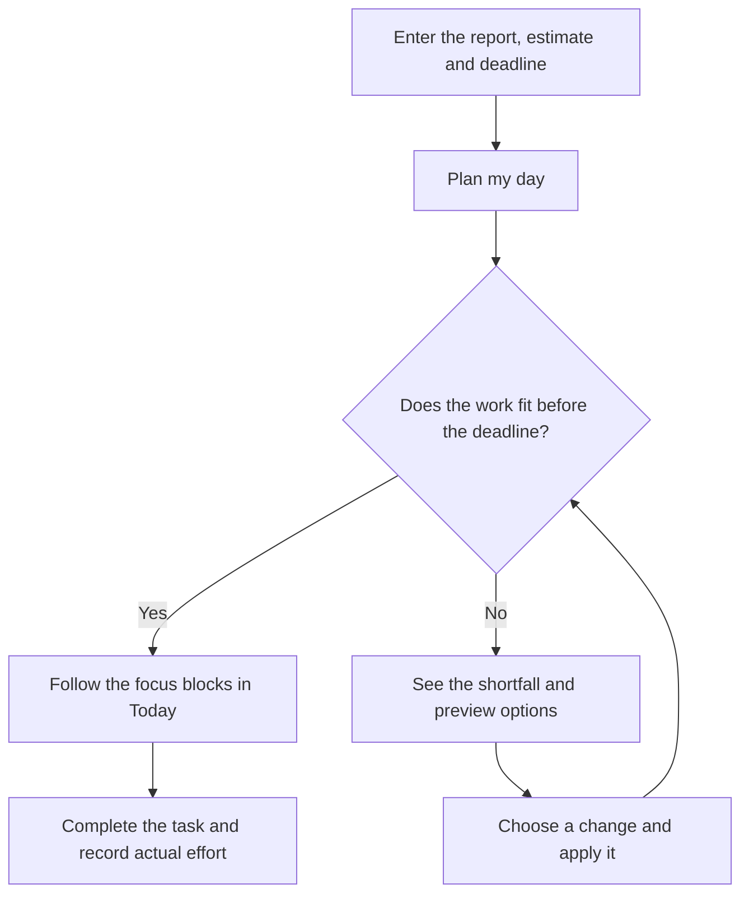
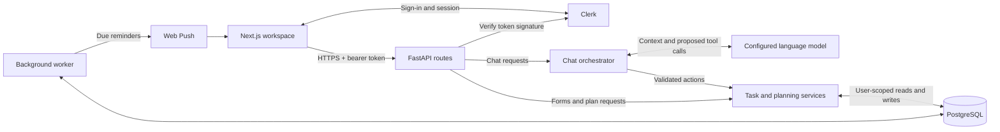

# LifeOS

LifeOS helps people decide **when their work will fit**. A student can enter a deadline and an effort estimate, see where the work fits around classes and routines, and compare changes when the calendar gets too tight.

[Download the illustrated project guide (PDF)](output/pdf/lifeos-project-guide.pdf) · [Frontend setup](frontend/README.md) · [Backend setup](backend/README.md)

## Use case · Can Priya finish her report by 16:30?

Priya is writing a database systems report around a study group and a weekly gym session. She estimates three hours of work. Her completed study tasks have taken 1.6 times their estimates, so LifeOS reserves **4 hours 48 minutes**. The work fits before her original 18:00 deadline. When the deadline moves to 16:30, Priya needs to know which commitment she can move.

## User flow

These screenshots show the LifeOS workspace using fictional data, an isolated demo identity and a disposable SQLite database. The task, scheduling and conflict routes produced the values shown. Times are local to Asia/Kolkata.

### 1. Enter the commitment

In **Tasks**, Priya enters “Finish database systems report,” sets the deadline to Sunday at 18:00, and selects **Study** with an estimate of **180 minutes**. Choosing **Create task** saves these inputs. The original estimate stays visible even when the planner uses a calibrated value.

### 2. Find time around existing commitments

From **Today**, Priya chooses **Plan my day**. The first report block runs from 09:00 to 09:50. Her study group occupies 10:00–12:00, and the report resumes at 12:10. The four report blocks total 288 minutes and finish at 17:08, ahead of the original deadline.

### 3. See what the earlier deadline changes

Priya edits the report in **Tasks** and changes its deadline to **16:30**. On **Today**, Capacity Guard flags a **28-minute shortfall**. Only 260 working minutes are available before the new deadline, against 288 minutes of study time needed. She chooses **See options**.

### 4. Compare the alternatives

Working until 21:00 still leaves the same shortfall because the extra hours come after 16:30. Moving Sunday’s gym session to **Monday at 14:00** frees time before the report is due. **Ask for more time** provides a draft Priya can copy and send herself. She selects **Apply** under **Move something flexible**.

### 5. Check the revised plan

**Today** now shows **All fit**, one task still due today and **25 minutes** of open working time left across the day. The report keeps its 16:30 deadline. After finishing it, Priya can mark it complete and record actual effort for future study estimates.

## System design

| Component | Responsibility |
| --- | --- |
| Workspace and identity | Next.js renders Tasks, Today, Chat and Insights. Clerk supplies the session token. FastAPI verifies it and uses its subject to scope database access. PostgreSQL row-level security enforces the user boundary. |
| Chat and imports | Chat interprets a request as a proposed tool call. The backend validates arguments, resolves task references and asks for clarification when needed. Chat deletes and batches of more than three writes require confirmation. Users can also review tasks extracted from a syllabus or photo before saving them. |
| Planner and Capacity Guard | The planner builds free intervals from local working hours, events and recurring routines. It leaves buffers around busy time, calibrates effort from completion history, ranks open tasks and places focus blocks. Capacity Guard compares the cumulative work due by each deadline with the available minutes before it. |
| Storage and background work | PostgreSQL stores tasks, events, preferences, routines, plan blocks, conflicts, reminders and action history. A separate Python worker processes due reminders, sends configured browser pushes and runs scheduled jobs such as priority updates and Google Calendar sync for connected accounts. |

### From button press to saved plan

| User action | Request | Result |
| --- | --- | --- |
| Create the report | `POST /api/tasks` | Validates and saves the task, schedules applicable reminders and checks deadline capacity. |
| Plan my day | `POST /api/plan/rebuild` | Recalculates priorities and rebuilds upcoming focus blocks for seven days by default. Today reads the result through `GET /api/today`. |
| Bring the deadline forward | `PATCH /api/tasks/{id}` | Updates the deadline and reruns the capacity check. The shortfall appears in Today. |
| See options | `GET /api/conflicts/{id}/options` | Simulates candidate changes and returns each preview with its remaining shortfall. |
| Apply the gym move | `POST /api/conflicts/{id}/resolve` | Records an override for that gym occurrence, rebuilds the plan and logs the change as an undoable batch. |

The scheduling and capacity calculations run in Python. The optional language model interprets chat requests and proposes actions. A task entered through the form reaches the same planning services directly.

Implementation details are in the [chat orchestrator](backend/app/services/chat_orchestrator.py), [planning service](backend/app/services/planning_service.py), [scheduler](backend/app/services/scheduler.py) and [conflict service](backend/app/services/conflict_service.py).
